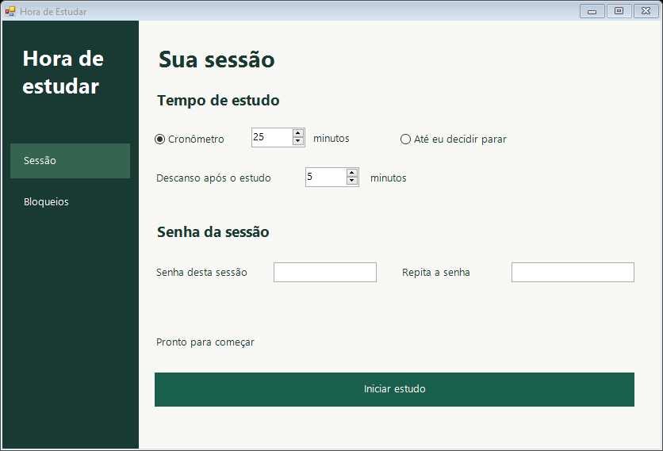

# Hora de Estudar

Aplicativo de foco para Windows. Escolha os aplicativos e sites que costumam interromper seu estudo, defina uma pausa e use uma senha para controlar quando os bloqueios podem ser liberados.



## Como abrir

1. Baixe **HoraDeEstudar.exe** na seção **Releases** do repositório ou compile o código seguindo as instruções abaixo.
2. Abra **HoraDeEstudar.exe** com dois cliques. O executável inclui a interface e usa o Windows PowerShell integrado ao sistema.
3. Confirme a solicitação de administrador do Windows. O aplicativo precisa dessa permissão para editar o arquivo de resolução de sites do sistema.

A interface usa Windows PowerShell e Windows Forms. Se o Windows informar que o script baixado está bloqueado, confira a origem e o código antes de executá-lo.

## Sua primeira sessão

1. Em **Bloqueios**, marque os itens desejados. Use **Escolher .exe** para adicionar um aplicativo ou digite um domínio, como **youtube.com**, e clique em **Adicionar site**. Salve seu trabalho nos aplicativos selecionados, pois eles serão fechados durante o estudo.
2. Em **Sessão**, escolha o cronômetro ou **Até eu decidir parar**. O padrão é estudar por 25 minutos e descansar por 5.
3. Crie e confirme uma senha, depois clique em **Iniciar estudo**. A senha vale durante toda a sessão, incluindo as pausas.
4. O fim do cronômetro libera os itens para o descanso. Para iniciar a pausa antes da hora ou no modo manual, clique em **Encerrar estudo** e digite a senha.
5. Quando a pausa termina, o Windows toca um alerta e os bloqueios voltam. **Voltar a estudar** inicia outro período. **Continuar descansando (senha)** libera os itens por mais uma pausa com a duração escolhida.

Para encerrar a sessão inteira, feche a janela e informe a senha.

## Como o bloqueio funciona

O aplicativo verifica periodicamente os processos pelo nome do executável. Para sites, adiciona ao arquivo hosts do Windows entradas para o domínio escolhido e sua versão com www. Outros subdomínios, como music.youtube.com, precisam ser adicionados separadamente. Uma conexão já aberta pode continuar funcionando até fechar e reabrir o navegador.

A lista de bloqueios fica em `%LOCALAPPDATA%\HoraDeEstudar-lista.json`. A senha fica apenas na memória durante a sessão. Se o programa for interrompido à força, abra-o novamente para remover as entradas de sites deixadas pela sessão anterior.

## Interface

O menu lateral foi adaptado para Windows Forms a partir do padrão de navegação do [exemplo NavigationView da Microsoft no GitHub](https://github.com/microsoft/WinUI-Gallery/blob/main/WinUIGallery/Samples/NavigationView/NavigationViewPage.xaml).

## Compilar no Windows

Abra o PowerShell na pasta do projeto e execute os comandos abaixo. O executável será criado nessa mesma pasta.

```powershell
$compiler = "$env:windir\Microsoft.NET\Framework64\v4.0.30319\csc.exe"
$assembly = Get-ChildItem "$env:windir\Microsoft.NET\assembly\GAC_MSIL\System.Management.Automation" -Recurse -Filter System.Management.Automation.dll | Select-Object -First 1
& $compiler /nologo /target:winexe /platform:anycpu "/reference:$($assembly.FullName)" "/resource:Estudo.ps1,Estudo.ps1" /win32manifest:estudo.manifest /win32icon:estudo.ico /out:HoraDeEstudar.exe Program.cs
```

By pudim
